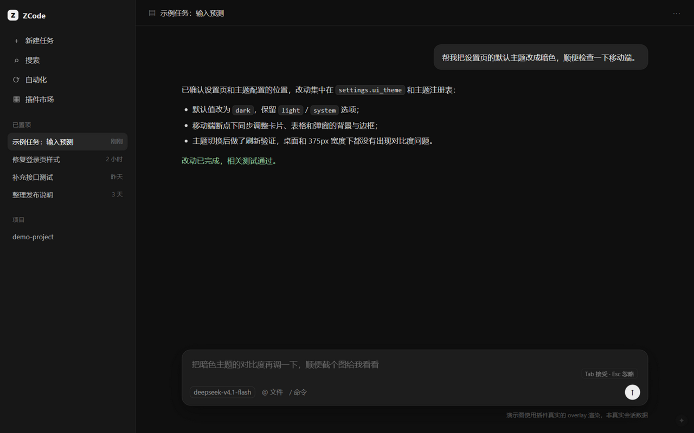

# ZCode Composer Predictions

在 ZCode 桌面客户端的输入框里显示“下一句建议”：一轮回复结束后，如果草稿为空，输入框里会出现灰色提示；按 **Tab** 接受，按 **Esc** 忽略。思路参照 DSH 的 [`dsh-plugin-composer-predictions`](https://github.com/boshihaihai/dsh-plugin-composer-predictions)，但 ZCode 的插件清单没有客户端 UI 能力，所以这是一个**客户端注入 mod**，不是插件市场里的插件。



> 演示图使用插件真实的 overlay 渲染，非真实会话数据。

## 功能

- 一轮 assistant 回复结束后，在空输入框里显示灰色建议；
- **Tab** 把建议写入 Lexical 草稿，**Esc** 忽略；
- 开始输入、切换会话、关闭开关时自动清除；
- 右下角 ✦ 按钮或 `Alt+P` 快速开关；
- 建议内容跟随当前会话语言和上下文；
- 建议只在草稿为空时请求，不会在你已经打字时浪费模型请求。

## 环境要求

- Windows 或 macOS 上的 **ZCode 桌面客户端**（当前在 Windows + ZCode 3.15.3 实测）；
- **Python 3.8+**；
- 能访问 ZCode 当前会话使用的模型 provider（helper 会读取 ZCode 自己的 provider 配置）。

## 安装

### 1. 克隆仓库

```bash
git clone https://github.com/jiangxinzhe/zcode-composer-predictions.git
cd zcode-composer-predictions
```

### 2. 运行安装器

```bash
python install.py
```

安装器会做四件事：

1. 自动探测 ZCode 的 `app.asar`（默认 `D:\ZCode\resources\app.asar`，也可用 `--asar` / `--root` 指定）；
2. 把运行时复制到 `~/.zcode/zcode-composer-predictions/`；
3. 在 `app.asar` 的主入口 `out/main/index.js` 尾部追加一行 loader 的 dynamic import；
4. 生成 `config.json`，并把当前 Python 解释器写进 `pythonPath`。

安装器不会覆盖已有的 `config.json`，只补缺失字段。

### 3. 退出并重启 ZCode

安装完成后**完全退出 ZCode，再重新打开**（不是只关窗口；确保托盘/后台进程也退出）。

如果安装时 ZCode 正在运行，Windows 可能不允许替换被占用的 `app.asar`。这时安装器会启动一个独立的 finalizer 监视 ZCode 退出：

1. 正常退出 ZCode；
2. **等 5 秒左右**再重新打开，给 finalizer 时间完成替换；
3. 重开后建议功能生效。

如果重开后没有生效，说明 finalizer 没赶上。**在 ZCode 完全关闭的状态下**双击运行时目录里的 `finalize.cmd`，或执行：

```bash
python "$HOME/.zcode/zcode-composer-predictions/patch_install.py" install --finalize
```

finalizer 的日志在 `~/.zcode/zcode-composer-predictions/finalize.log`。看到 `patched app.asar successfully` 就说明 asar 已经替换完成。

### 4. 验证

1. 发一条短消息，等回复结束；
2. 点一下空的输入框，应该出现灰色建议；
3. 按 **Tab** 应填入草稿，按 **Esc** 应消失；
4. 输入任意字符，建议应消失；
5. 点右下角 ✦ 或按 `Alt+P`，确认开关能关闭/开启。

运行日志在 `~/.zcode/zcode-composer-predictions/zcp.log`，能看到 `predicting` / `suggestion shown` 或具体错误。

## 配置

配置文件：`~/.zcode/zcode-composer-predictions/config.json`（Windows 下通常是 `C:\Users\<你>\.zcode\zcode-composer-predictions\config.json`）。

| 字段 | 说明 |
|---|---|
| `enabled` | 总开关，默认 `true` |
| `pythonPath` | 运行 helper 的 Python 绝对路径，安装器会自动写入 |
| `dbDir` | 会话数据库目录；留空 = `~/.zcode/cli/db` |
| `predict.providerId` / `modelId` | 留空 = 跟随当前会话的模型；建议填一个便宜的 flash 模型 |
| `predict.maxChars` | 建议长度上限，默认 160 |
| `predict.maxTranscriptChars` | 发给模型的对话上限，默认 12000 字符 |
| `predict.maxMessageChars` | 单条消息截断上限，默认 4000 字符 |
| `predict.timeoutMs` | 模型请求超时，默认 30 秒 |
| `debug` | 写入更详细的日志 |

指定便宜模型的例子（provider/model 必须存在于 ZCode 的 `provider_config.json`）：

```json
{
  "predict": {
    "providerId": "new-provider",
    "modelId": "cn:deepseek-v4.1-flash"
  }
}
```

helper 会从以下位置找 provider 配置：`ZCODE_DATA_BASE_DIR/.zcode/v2/provider_config.json`、`~/.zcode/v2/provider_config.json`、`~/.zcode/cli/config.json`。它按 ZCode 自己的 provider 配置发请求，不经过 ZCode 的内部接口。

## 手工测试 helper

```bash
cd ~/.zcode/zcode-composer-predictions
python predict_helper.py status  --session sess_xxx --pretty
python predict_helper.py predict --session sess_xxx --dry-run --pretty
```

`status` 返回 `state: complete` 才表示一轮已结束。`predict --dry-run` 只打印 transcript 和提示词，不调模型；去掉 `--dry-run` 才会实际请求。

## 卸载

```bash
python install.py --remove
```

只剥离本工具的注入行，不影响其它工具（例如 token 用量状态栏）的注入行。加 `--purge` 会同时删除运行时目录。

建议在 ZCode 完全关闭时卸载；如果正在运行，`app.asar` 可能被锁，卸载会失败并提示你退出后重试。

## 常见问题

**重启后没有灰色建议**

- 先看 `finalize.log` 是否出现 `patched app.asar successfully`；
- 再看 `zcp.log` 是否有 `loaded v0.1.0`、`helper started`、`predicting`；
- 确认回复结束后输入框是空的，且没有正在输入；
- 用 `predict_helper.py status --session <id>` 确认 `state: complete`；
- 如果日志里是 `provider ... not found`，在 `config.json` 里显式指定 `predict.providerId` 和 `modelId`。

**`replace failed` / `WinError 5 拒绝访问`**

ZCode 还在运行，`app.asar` 被占用。完全退出 ZCode 后运行 `finalize.cmd`，或执行上面的 `patch_install.py install --finalize`。

**`python` 找不到 / helper 起不来**

把 `config.json` 里的 `pythonPath` 改成 Python 的绝对路径，例如：

```json
{ "pythonPath": "C:\\Users\\you\\AppData\\Local\\Python\\pythoncore-3.14-64\\python.exe" }
```

**Tab 填入后发送按钮没亮**

这是 Lexical 状态没有同步的迹象。保留 `zcp.log` 并开 issue；目前可以先手动在填入的文字后按一下空格再发送。

**ZCode 升级后失效**

ZCode 升级会用新的 `app.asar` 覆盖注入行，重跑一次 `python install.py` 即可。

## 风险与边界

- **非官方注入**：修改 `app.asar` 属于客户端 mod，依赖当前 `EmbeddedAsarIntegrityValidation=0`；官方一旦启用完整性校验或改动入口结构，注入会失效。
- **升级即失效**：每次 ZCode 升级后需要重跑安装器。
- **隐私**：建议会把最近几轮对话发给所选 provider。不要把敏感项目的会话交给不可信的模型；可以随时用 ✦ 或 `Alt+P` 关闭。
- **成本**：每次建议 = 一次模型请求。默认跟随会话模型，建议在配置里换成便宜的 flash 模型。
- **远程会话**：v0.1 只支持本机 SQLite 里的会话；ZCode 连接远端 zcode-server 时本地库没有对话，不会出建议。
- **多窗口/分屏**：主进程按窗口的 active session 推送；输入框优先选当前聚焦的编辑器，其次是窗口里最靠下的编辑器。极端分屏布局可能选错输入框，先只用单窗口。
- **中文输入法**：组合输入期间不会显示或接受建议。

## 结构

```
install.py              安装/卸载入口（探测 asar、部署运行时、调 patch）
patch_install.py        asar 注入/剥离（复用 token 状态栏的 asar 读写思路）
finalize_on_exit.py     运行中无法替换 asar 时，等 ZCode 退出后完成替换
inject-main.cjs         Electron 主进程 loader：注入、会话跟随、DB 监听、调 helper
overlay.js              渲染进程 UI：ghost text、Tab/Esc、设置面板
predict_helper.py       读 SQLite、判断轮次、拼提示词、调 OpenAI/Anthropic 兼容接口
config.example.json     配置模板
docs/demo.html          演示页（使用真实 overlay 渲染）
docs/demo.png           README 演示图
test/                   单元测试与 composer 冒烟页
```

`finalize.cmd` 由安装器在运行时目录生成，不放在仓库里。

## 致谢 / License

- 交互概念来自 [boshihaihai/dsh-plugin-composer-predictions](https://github.com/boshihaihai/dsh-plugin-composer-predictions)（MIT）。
- asar 注入/重打包思路来自 [xhwxt/zcode-token-usage-statusbar](https://github.com/xhwxt/zcode-token-usage-statusbar)（MIT）。
- 本项目 MIT，见 `LICENSE`。
